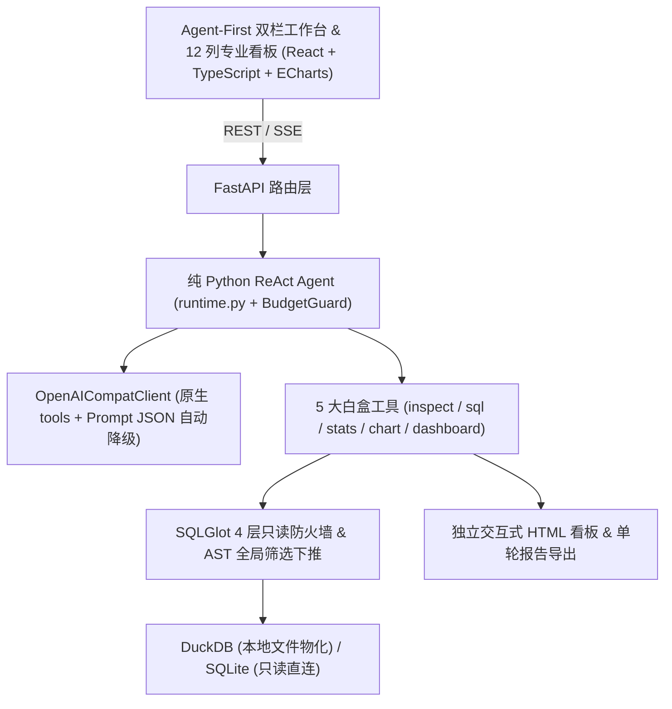

# DataPilot-Agent

<p align="center">
  <strong>纯 Python 原生驱动 · 白盒只读安全 · 一句话搭建 12 列专业 BI 看板的开源数据分析 Agent</strong>
</p>

<p align="center">
  <a href="LICENSE"></a>
  
  
  
  
  
  
</p>

---

**DataPilot-Agent** 是一款本地优先、白盒透明、零重型框架的开源 AI 数据分析 Agent 与 BI 看板平台，面向电商经营、线上用户行为、短视频内容运营及日常多表探索等真实分析场景。

相比传统“问一句、写一条 SQL、画一张图”的单步问答工具，本项目以纯 Python 原生实现 **ReAct 多步分析循环** 与 **SQLGlot AST 改写引擎**：遇到异常波动会自动下钻归因、查出 0 行会自动采样枚举值自纠、所有取数均以高可读性只读 SQL 白盒呈现，并支持**一句话生成可全局筛选联动的 12 列专业 BI 看板与独立离线 HTML 报告**。

---

## 解决的问题与适用人群

### 解决的 4 个真实痛点
- **开放问题答不深**：面对“为什么某月 GMV 下滑”这类归因问题，自动拆解为趋势探查 → 异常定位 → 维度对比 → 贡献度拆解的多步闭环。
- **脏数据查出 0 行就卡死**：真实表枚举值往往与口语不一致（如 `'completed'` vs “已完成”），查得 0 行时自动采样真实字段值并修正 SQL 重跑。
- **黑盒脚本难审计、大模型算错数**：拒绝 `exec(python)` 跑任意代码；所有计算下推至受控只读 SQL，复杂归因与统计由确定性数学引擎完成，每条结论强绑定 `[ref:res_xxx]` 证据。
- **看板搭建慢、难二次筛选与分享**：无需繁琐拖拽，一句话构建 KPI + 双轴趋势 + 拆解图大盘，支持**全局日期/维度筛选安全下推刷新**与**单个 HTML 文件离线分享**。

### 适用人群
- **业务 / 运营 / 产品经理**：零 SQL 门槛，上传本地 Excel / CSV 即可完成异常复盘，并一键导出可双击打开的交互式 HTML 看板发给团队。
- **数据分析师 / BI 工程师**：快速完成多表关系发现与探索，随时展开复制带语法高亮的规范缩进 SQL，避免多明细表关联扇出踩坑。
- **AI Agent 开发者与学习者**：不套壳 LangChain / CrewAI，用精炼的纯 Python 代码完整展示 ReAct 循环、双通道 Tool Calling、AST 安全护栏与单步 vs 多步 Eval 评测方法。

---

## 核心功能

- **Agent-First 双栏工作台（Workspace）**
  - **实时 SSE 推理轨迹**：左侧可折叠展示每一步思考摘要、工具调用、耗时与高可读性白盒 SQL；右侧画布随进度实时渲染多图分析面板或 12 列专业看板。
  - **5 大白盒工具**：`inspect_schema`（表结构与枚举采样）、`run_sql`（只读查询与事实提取）、`analyze_stats`（贡献度 / 异常 / 相关性确定性统计）、`render_chart`（单轮多图校验）、`build_dashboard`（12 列看板落库）。
  - **高可读性 SQL 呈现**：后端 SQLGlot 自动缩进并对多 CTE / 长条件智能断行排版，前端提供 IDE 级多色语法高亮、行号、主子句引导线、自动换行与一键格式化。
- **一句话搭建专业 BI 看板（Pro Dashboards）**
  - **12 列响应式专业网格**：支持顶部 KPI 指标卡（含环比徽章）、全宽双轴组合图（`combo`）、漏斗图（`funnel`）、多系列柱/折/面积图等 9 类 ECharts 图表，支持卡片宽窄（3/4/6/12 列）与顺序快捷调整。
  - **SQLGlot AST 全局筛选下推**：筛选日期范围或维度多选时，在 AST 层安全改写各卡片 SQL 的 `WHERE` 条件并二次校验执行，零字符串拼接、免疫 SQL 注入。
  - **亮/暗大屏切换 & 独立 HTML 导出**：一键切换暗色 BI 大屏，支持将完整看板或单轮多图分析导出为自包含交互式 `.html` 文件。
- **白盒只读安全护栏**
  - **4 层 SQLGlot AST 防火墙**：拦截写操作/DDL、多语句堆叠、危险外访函数（如 `read_csv`、`getenv`）及越权表访问；自动识别双 `1:N` 明细表直接 JOIN 的**笛卡尔扇出风险**（`FAN_OUT_RISK`）并强制补全 `LIMIT` 保护。
- **本地数据中心与多模型兼容（Data & Settings）**
  - **零运维数据接入**：支持上传 `CSV / TSV / Excel 多 Sheet / JSON / Parquet` 自动物化进 DuckDB，或只读直连本地 SQLite，自动推断表关系并支持在线编辑 Markdown 业务字典。
  - **双通道模型兼容**：内置 DeepSeek / 通义千问 / 智谱 / OpenAI / Gemini / 本地 Ollama 预设；原生 OpenAI `tools` 优先，不支持 `tools` 的模型自动无感降级为 Prompt JSON 模式。

---

## 系统架构



---

## 目录结构

```text
DataPilot-Agent/
├── backend/
│   ├── app/
│   │   ├── main.py / config.py / models.py / db.py   # FastAPI 入口、配置、契约与 8 表 SQLite WAL 仓储
│   │   ├── ai/                                       # 双通道 OpenAI 兼容客户端与多厂商预设
│   │   ├── agent/                                    # ReAct 主循环、工具注册表、5 大工具、确定性统计引擎
│   │   ├── engine/                                   # DuckDB/SQLite 引擎、文件解析、AST 防火墙与筛选下推、HTML 导出
│   │   └── routers/                                  # sources / chat / dashboards / settings
│   └── tests/                                        # 后端自动化测试套件
├── frontend/src/                                     # React 18 + TypeScript + Tailwind v4 + ECharts 5
├── examples/                                         # 开箱示例数据（电商多表 CSV + 短视频多 Sheet Excel）
├── evals/                                            # 单步 Text-to-SQL vs ReAct Agent 对比评测套件
├── .env.example                                      # 可选环境变量配置模板
└── pyproject.toml                                    # Python 打包配置（仅 10 个核心依赖）
```

---

## 快速启动

### 环境要求
- **Python 3.11+**（推荐 `uv`、`conda` 或 `venv`）
- **Node.js 20+** 与 **pnpm**

### 1. 启动后端

```bash
git clone https://github.com/Asahi230035/DataPilot-Agent.git
cd DataPilot-Agent

pip install -e .
uvicorn app.main:app --app-dir backend --host 127.0.0.1 --port 8000
```

### 2. 启动或构建前端

```bash
cd frontend
pnpm install
pnpm dev      # 开发模式：http://127.0.0.1:5173（自动代理 /api 至 8000）
pnpm build    # 生产构建：输出至 backend/static/，直接访问 http://127.0.0.1:8000
```

启动后访问 `http://127.0.0.1:8000`（接口文档：`http://127.0.0.1:8000/docs`）：
1. 在 **「数据与字典」** 一键加载内置电商或短视频示例数据；
2. 点击左下角 **「模型设置」** 配置 DeepSeek / 通义千问 / 智谱 / OpenAI / Ollama 并测试连通性；
3. 进入 **「Agent 工作台」** 提问归因分析，或在 **「专业看板库」** 一句话生成可筛选的 12 列专业看板。

---

## 测试与评测

```bash
# 运行单元测试与代码检查
pytest -v && ruff check backend evals/run_eval.py

# 使用真实大模型运行单步 Text-to-SQL vs ReAct Agent 对比评测（14 题）
python evals/run_eval.py --base-url https://api.deepseek.com/v1 --model deepseek-chat --api-key "$DEEPSEEK_API_KEY"
# 无 API Key 时可附加 --mock 验证离线评测流水线
```

---

## 开源协议

[MIT License](LICENSE) © 2026 [Asahi230035](https://github.com/Asahi230035)
